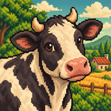
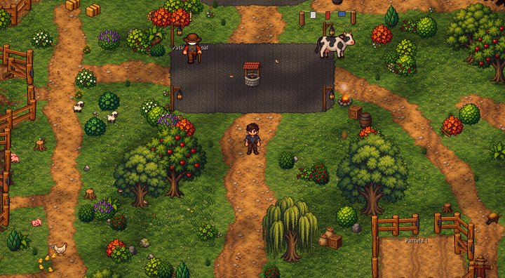
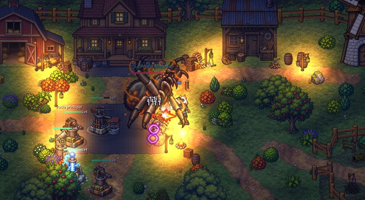
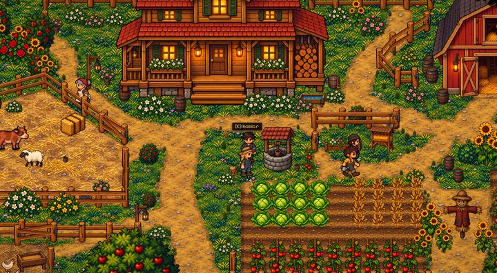
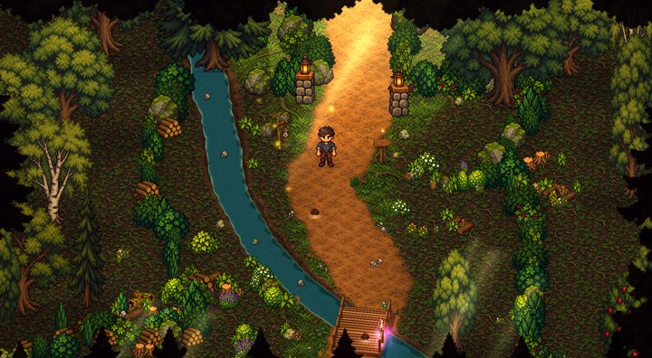

<h1 align="center">Hessel's Farm — farm by day, defend by night</h1>

  <b>Closed alpha on Google Play — not public yet</b> ·
  Android · Godot 4.7 · GDScript · pixel art

> **Portfolio excerpt — not the full source.** This repository contains a handful of files from a private
> codebase so reviewers can see how I write code. The game logic, the world, saves, the economy,
> monetisation, the art and the build configuration are intentionally left out. All rights reserved (see [LICENSE](LICENSE)).

  
  

  
  

Google Play screenshots (Spanish UI)

## What it is

A pixel-art farming game in a 3/4 top-down view with a twist: **you farm by day and defend the farm by night**.
You inherit your grandfather's farm, plant and harvest, raise animals, talk to neighbours and take on quests.
When night falls, waves of creatures come in from different edges of the map and you hold them off with
turrets, traps and walls, plus your own weapons, which you upgrade in the workshop. Bosses, a forest to explore
and a dark labyrinth under the farm expand the world.

Touch controls are fully editable: fixed or floating joystick, and every button can be moved and resized.

## Status

| | |
|---|---|
| Google Play | **Closed alpha — not public yet** |
| Started | Late July 2026 |
| First alpha on Google Play | Early October 2026 |
| Current version | 0.3.2 (versionCode 12), uploaded to the closed alpha track on October 18, 2026 |
| Still in development? | **Yes**, actively |

## Scale of the codebase

- **~49,000 lines of GDScript** in the game, plus about 17,000 lines of headless test and review tools
- **18 custom shaders** (water, rain, color grading, relief, sway, lighting, occlusion silhouettes, impacts…)
- **16 autoload singletons** (data, save, economy, quests, relations, inventory, achievements, audio, music, ads, billing…)
- 230+ commits

## Tech stack

**Game:** Godot 4.7, GDScript, canvas-item shaders, `MultiMesh` batching for effects, Android export (AAB).
AdMob and Google Play Billing through their own autoloads.

## Engineering highlights

- **Seeing enemies behind trees.** [`EnemySilhouettes.gd`](scripts/world/EnemySilhouettes.gd) finds enemies hidden
  behind tall props using a spatial grid of static objects, rebuilt in time-budgeted slices (thousands of props in the
  forest), with hysteresis so the outline doesn't flicker. [`enemy_silhouette.gdshader`](scripts/world/enemy_silhouette.gdshader)
  then paints a red silhouette **only over the opaque pixels of the objects in front**, so the visible part of the enemy
  stays normal.
- **Effects that cost almost nothing.** [`ImpactPool.gd`](scripts/entities/ImpactPool.gd) and
  [`ParticlePool.gd`](scripts/entities/ParticlePool.gd) draw every bullet impact and every piece of debris through two
  or three `MultiMesh` batches with fixed capacity, recycling the oldest entry instead of creating nodes.
- **Lighting without 2D lights.** [`lab_dark.gdshader`](scripts/world/lab_dark.gdshader) darkens the labyrinth in a
  single multiplied full-screen pass: a soft warm circle around the player plus up to eight local lights, with dithering
  to avoid banding on 8-bit screens, while the HUD stays visible.
- **Water from a mask.** [`forest_water.gdshader`](scripts/world/forest_water.gdshader) turns a continuous mask into
  curved shorelines, depth, foam, a wavy reflection of the far bank, sparkles and rain rings.
- **Controls players can rearrange.** [`TouchLayout.gd`](scripts/ui/TouchLayout.gd) lets players drag and scale each
  touch control, switch the joystick between fixed and floating, and stores the layout separately from the save game.

## What's in this excerpt

| File | What it shows |
|---|---|
| `scripts/world/EnemySilhouettes.gd` + `enemy_silhouette.gdshader` | Occlusion silhouettes: spatial grid, time budgets, masked shader |
| `scripts/entities/ImpactPool.gd` | Bullet impacts batched with `MultiMesh`, fixed cap |
| `scripts/entities/ParticlePool.gd` | Bounded debris particles in two batches |
| `scripts/world/lab_dark.gdshader` | Single-pass darkness with a player light and local lights |
| `scripts/world/forest_water.gdshader` | Stylised water with shoreline, reflection and rain |
| `scripts/ui/TouchLayout.gd` | Player-editable touch controls |

Comments and in-game text are in Spanish.

**Not included on purpose:** the project file and export presets, the farm, night waves, enemies and turrets, saves,
economy, quests and dialogue, ads and billing, art and audio, and credentials. The excerpt can't be built or run.

---

Built by **Cristian Luis Celie**: [GitHub profile and CV](https://github.com/keblardo) · cristiancelie07@gmail.com
